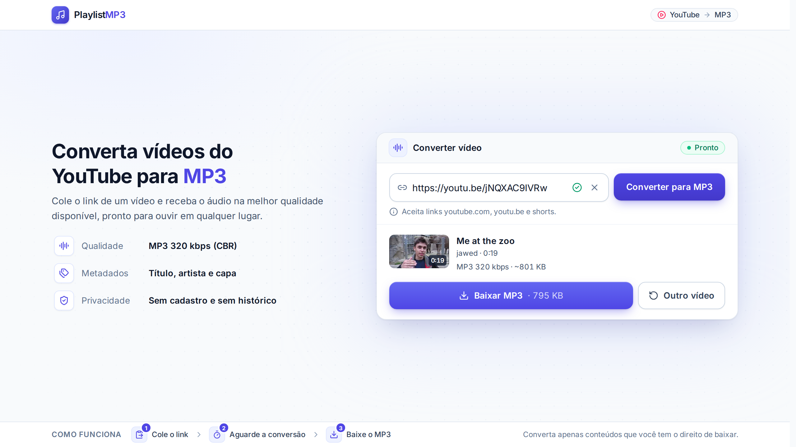

# PlaylistMP3

Aplicação web minimalista: cole o link de um vídeo do YouTube e baixe o áudio em **MP3 320 kbps**, com título, artista e capa embutidos.

- Aceita somente vídeos do YouTube: `youtube.com/watch?v=…`, `youtu.be/…` e `youtube.com/shorts/…`
- Sem login, sem histórico, sem banco de dados
- Os arquivos ficam em RAM (tmpfs) e são apagados logo após o download



> Projeto educacional, para uso pessoal. Leia o [aviso legal](#aviso-legal) antes de usar.

## Stack

| Camada | Tecnologia |
|---|---|
| Frontend | React 19, Vite 7, TypeScript, Tailwind CSS 4, Lucide |
| Backend | Python 3.12, FastAPI, yt-dlp, ffmpeg, Deno (resolve os desafios JS do YouTube) |
| Infra | Docker Compose (nginx serve o SPA e faz proxy de `/api`) |

## Como rodar

```bash
cp .env.example .env            # opcional: todas as variáveis têm padrão
docker compose up -d --build    # http://localhost:8080
```

### Desenvolvimento (hot-reload)

```bash
docker compose -f docker-compose.dev.yml up --build
# Frontend (Vite): http://localhost:5173
# API + Swagger:   http://localhost:8000/api/docs
```

Testes do backend:

```bash
docker compose -f docker-compose.dev.yml exec backend python -m pytest -q
```

## API

| Método | Rota | Descrição |
|---|---|---|
| `GET` | `/api/health` | Status e versão do yt-dlp |
| `POST` | `/api/info` `{url}` | Valida a URL e devolve título, canal, duração, thumbnail e tamanho estimado |
| `POST` | `/api/convert` `{url}` | Cria um job de conversão (202) e devolve o `id` |
| `GET` | `/api/jobs/{id}` | Status: `queued` → `extracting` (com %) → `converting` → `ready` ou `error` |
| `DELETE` | `/api/jobs/{id}` | Cancela o job ou descarta o arquivo |
| `GET` | `/api/download/{id}` | Entrega o MP3 e o apaga em seguida (download único) |

Os erros vêm como `{code, message}`, com estes códigos: `INVALID_URL`, `PRIVATE`, `UNAVAILABLE`, `AGE_RESTRICTED`, `MEMBERS_ONLY`, `LIVE`, `TOO_LONG`, `BLOCKED`, `NETWORK`, `NOT_FOUND`, `EXPIRED` e `UNKNOWN`.

## Limpeza dos arquivos temporários

1. **Após o download:** uma `BackgroundTask` apaga o diretório do job assim que a resposta termina.
2. **Cancelamento:** os botões "Cancelar" e "Converter outro vídeo", e também fechar a aba, enviam um `DELETE` ao servidor.
3. **Varredura periódica** (`CLEANUP_INTERVAL`): remove MP3 não baixados há mais de `FILE_TTL` e diretórios órfãos.
4. **Startup e shutdown:** o diretório temporário é esvaziado por completo.
5. **tmpfs:** os arquivos vivem em RAM, com limite definido por `TMPFS_SIZE`, e nunca tocam o disco.

## Quando o YouTube bloquear

Os sintomas são HTTP 403 ou a mensagem "Sign in to confirm you're not a bot".

1. **Atualize o yt-dlp.** Isso resolve a maioria dos casos:
   ```bash
   YTDLP_VERSION=latest docker compose build --no-cache backend && docker compose up -d
   ```
   Também é possível usar `nightly` ou fixar uma versão no `.env`.
2. **Ative o provedor de PO token** ([bgutil-ytdlp-pot-provider](https://github.com/Brainicism/bgutil-ytdlp-pot-provider)). Para isso, descomente estas linhas no `.env`:
   ```
   COMPOSE_PROFILES=pot
   POT_PROVIDER_URL=http://pot-provider:4416
   ```
   e rode `docker compose up -d`.
3. **Configure uma conta do YouTube** (veja a próxima seção). O backend passa a usá-la automaticamente quando a tentativa anônima é bloqueada.

O backend já tenta novamente quando o download recebe HTTP 403, e a cada tentativa refaz a extração dos metadados. Sem conta configurada são até 3 tentativas anônimas. Com conta, no modo `fallback`, são 2 anônimas seguidas de 2 com a conta.

## Conta do YouTube (opcional)

O backend pode usar uma conta do YouTube como **plano B** quando o YouTube bloqueia a tentativa anônima (HTTP 403 ou "not a bot") ou quando o vídeo tem restrição de idade.

> **Não existe login com usuário e senha.** O yt-dlp não aceita mais esse tipo de login no YouTube, e o OAuth também foi removido. A única forma suportada é um arquivo `cookies.txt` com a sessão logada, exportado do navegador. Por isso nenhuma senha vai para o `.env`.

**Qual conta usar.** O código não depende da conta: ele só lê o `cookies.txt` configurado.

| Conta | Vantagens | Riscos |
|---|---|---|
| **YouTube Premium** | Dispensa PO token e dá acesso a áudio de maior bitrate (~256 kbps) | Baixar fora do app viola os termos do YouTube, e a conta que você paga pode ser sinalizada ou suspensa |
| **Secundária gratuita** | Protege a conta principal | Não tem os benefícios do Premium |

**Modos** (`YOUTUBE_AUTH_MODE` no `.env`):

| Modo | Comportamento |
|---|---|
| `fallback` (padrão) | Tenta anônimo primeiro e usa a conta só quando o YouTube bloqueia ou exige idade |
| `always` | Usa a conta em todas as conversões, com mais qualidade e mais exposição da conta |
| `off` | Nunca usa a conta |

Sem o arquivo de cookies, o app funciona normalmente no modo anônimo. Os detalhes de autenticação aparecem **só nos logs do backend**: a interface e a API não revelam que existe uma conta configurada. Durante uma nova tentativa, a interface mostra apenas "Tentando rota alternativa…".

### 1. Exportar os cookies (janela anônima)

Siga este procedimento para os cookies não serem invalidados ("rotacionados") pelo próprio navegador logo depois:

1. Abra uma **janela anônima** e faça login no YouTube com a conta escolhida.
2. Nessa mesma aba, acesse `https://www.youtube.com/robots.txt`.
3. Exporte os cookies de `youtube.com` no formato **Netscape**. Uma opção é a extensão [Get cookies.txt LOCALLY](https://github.com/kairi003/Get-cookies.txt-LOCALLY), que precisa estar liberada para a janela anônima. Evite extensões de origem duvidosa, porque esse arquivo dá acesso à sua conta.
4. **Feche a janela anônima** sem sair da conta. Se você clicar em "Sair", a sessão é invalidada.

Detalhes no wiki do yt-dlp: [Exporting YouTube cookies](https://github.com/yt-dlp/yt-dlp/wiki/Extractors#exporting-youtube-cookies).

### 2. Instalar o arquivo

O backend lê o arquivo em `./secrets/` (pasta fora do Git, montada **somente leitura** no container) com o nome definido em `YOUTUBE_COOKIES_FILE` (padrão: `youtube-cookies.txt`). O container roda com **UID 1000**, por isso o arquivo precisa ser legível por esse usuário.

**Local (WSL2):**

```bash
# o navegador salvou em Downloads do Windows; ajuste o caminho
cp /mnt/c/Users/<seu-usuario>/Downloads/youtube-cookies.txt ./secrets/youtube-cookies.txt
chmod 600 ./secrets/youtube-cookies.txt
rm /mnt/c/Users/<seu-usuario>/Downloads/youtube-cookies.txt   # não deixe cópias soltas
```

No WSL o seu usuário costuma ter UID 1000. Confira com `id -u`.

**VPS:**

```bash
# na sua máquina
scp youtube-cookies.txt usuario@sua-vps:/caminho/do/playlistmp3/secrets/youtube-cookies.txt

# na VPS
cd /caminho/do/playlistmp3
sudo chown 1000:1000 secrets secrets/youtube-cookies.txt
chmod 700 secrets
chmod 600 secrets/youtube-cookies.txt
```

### 3. Atualizar quando expirar

Os cookies duram de semanas a meses. Quando expiram, o log do backend mostra uma mensagem como `os cookies da conta do YouTube expiraram ou foram rotacionados`. Para renovar, basta **repetir os passos 1 e 2 sobrescrevendo o arquivo**. Não é preciso rebuild nem restart, porque o arquivo é lido a cada conversão.

Para conferir o status:

```bash
docker compose logs backend | grep -iE "conta do youtube|autentica|cookies"
```

Na inicialização aparece, por exemplo, `conta do YouTube: modo fallback, cookies de sessão encontrados (youtube-cookies.txt)`. O conteúdo dos cookies nunca é registrado.

**Segurança:**
- O `.env`, a pasta `secrets/` e qualquer arquivo `*cookies*.txt` estão no `.gitignore`.
- A cada uso, o backend trabalha numa cópia temporária em RAM (`chmod 600`), apagada logo em seguida. O arquivo original nunca é alterado.
- Se o arquivo vazar, saia da conta em todos os dispositivos (Conta do Google → Segurança). Isso invalida os cookies.

## Configuração (`.env`)

| Variável | Padrão | Descrição |
|---|---|---|
| `APP_PORT` | `8080` | Porta do app em produção |
| `YTDLP_VERSION` | `2026.10.26` | Versão do yt-dlp (`latest` / `nightly` aceitos) |
| `MAX_DURATION` | `7200` | Duração máxima do vídeo, em segundos |
| `AUDIO_BITRATE` | `320` | Bitrate do MP3 (CBR, em kbps) |
| `MAX_CONCURRENT_JOBS` | `2` | Conversões simultâneas |
| `FILE_TTL` | `1800` | Segundos até um MP3 não baixado ser apagado |
| `CLEANUP_INTERVAL` | `300` | Intervalo da rotina de limpeza, em segundos |
| `TMPFS_SIZE` | `1g` | Tamanho máximo do diretório temporário em RAM |
| `LOG_LEVEL` | `INFO` | Nível de log do backend |
| `YOUTUBE_AUTH_MODE` | `fallback` | Uso da conta do YouTube: `fallback`, `always` ou `off` |
| `YOUTUBE_COOKIES_FILE` | `youtube-cookies.txt` | Nome do arquivo de cookies dentro de `./secrets/` |

> O estado dos jobs vive em memória, por isso o backend roda com **1 worker** do uvicorn.

## Aviso legal

Este é um projeto **educacional e de uso pessoal**, criado como laboratório de desenvolvimento. Ele **não tem vínculo** com o YouTube nem com o Google, e não é endossado por eles. "YouTube" é marca registrada da Google LLC.

- Use o PlaylistMP3 apenas com conteúdos que **você tem o direito de baixar**: obras próprias, conteúdo em domínio público, conteúdo sob licenças que permitam download ou casos autorizados pelo titular dos direitos.
- Baixar conteúdo do YouTube pode violar os [Termos de Serviço do YouTube](https://www.youtube.com/t/terms) e as leis de direitos autorais do seu país. **A responsabilidade pelo uso é inteiramente de quem usa.**
- O projeto não hospeda, não armazena e não distribui conteúdo. Os arquivos gerados ficam temporariamente na máquina de quem roda a aplicação e são apagados logo após o download.
- O software é fornecido "como está", sem garantias de nenhum tipo (veja a [licença](LICENSE)).

## Licença

Distribuído sob a licença [MIT](LICENSE). © 2026 Marcio Muzi.
